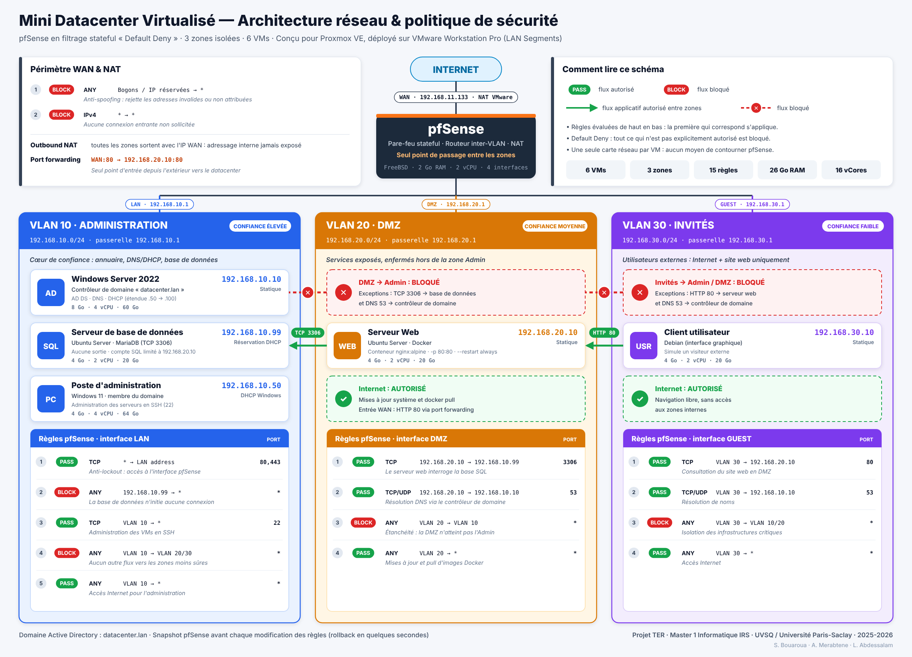
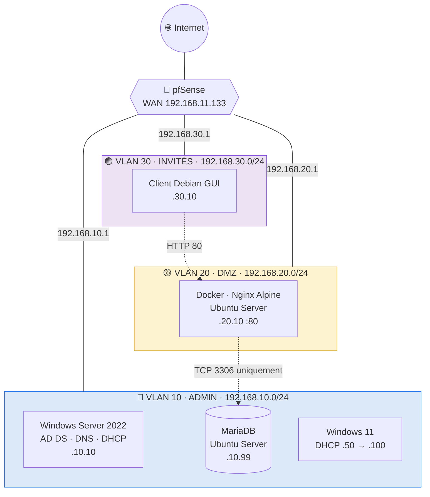
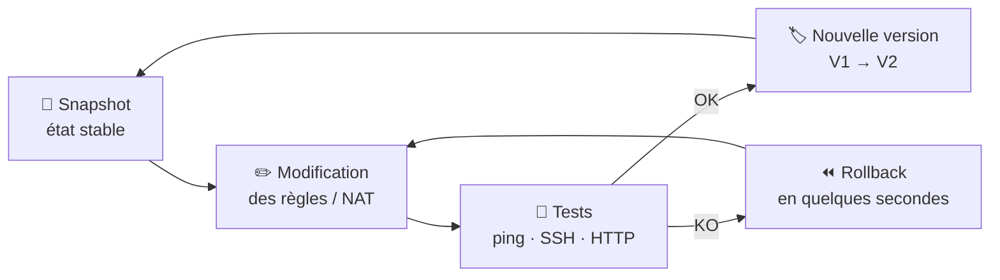

<div align="center">

# 🏢 Mini Datacenter Virtualisé avec Proxmox VE

**Infrastructure segmentée en 3 zones de sécurité, routée et filtrée par pfSense en politique *Default Deny***


<br>


[Architecture](#-architecture) •
[Sécurité](#-politique-de-filtrage) •
[Tests](#-tests-de-validation) •
[Proxmox → VMware](#-de-proxmox-ve-à-vmware-workstation) •
[Rapport PDF](docs/rapport-TER.pdf)

</div>

---

## 📌 En bref

| 🖥️ VMs | 🔒 Zones isolées | 🧱 Règles pare-feu | ⚙️ Ressources | 🌐 Point d'entrée exposé |
|:---:|:---:|:---:|:---:|:---:|
| **6** | **3 VLANs** | **15** sur 4 interfaces | **26 Go RAM · 16 vCores** | **1** (HTTP 80 → DMZ) |

> **Problématique :** comment concevoir une infrastructure virtualisée résiliente et sécurisée, capable de fournir des services hétérogènes (Windows et Linux), tout en respectant les bonnes pratiques de segmentation réseau ?

Le projet reproduit, à l'échelle d'un poste de travail, les briques d'un datacenter de production : **virtualisation**, **segmentation par zones de confiance**, **pare-feu stateful**, **annuaire centralisé**, **conteneurisation en DMZ** et **base de données cloisonnée**.

---

## 📑 Sommaire

1. [Architecture](#-architecture)
2. [Compétences mises en œuvre](#-compétences-mises-en-œuvre)
3. [Zones de sécurité](#-zones-de-sécurité)
4. [Plan d'adressage](#-plan-dadressage)
5. [Dimensionnement des VMs](#%EF%B8%8F-dimensionnement-des-vms)
6. [Politique de filtrage](#-politique-de-filtrage)
7. [Services déployés](#-services-déployés)
8. [Tests de validation](#-tests-de-validation)
9. [De Proxmox VE à VMware Workstation](#-de-proxmox-ve-à-vmware-workstation)
10. [Maintenance et continuité](#-maintenance-et-continuité)
11. [Évolutions prévues](#-évolutions-prévues)
12. [Structure du dépôt](#-structure-du-dépôt)
13. [Équipe](#-équipe)

---

## 🗺️ Architecture

<div align="center">
  
  <br><em>Zones, VMs, adressage, flux et règles pfSense sur un seul schéma</em>
</div>

<br>



**Principe clé :** chaque VM n'a **qu'une seule carte réseau**, branchée sur le segment de sa zone. pfSense est la seule machine à 4 interfaces (1 WAN + 3 zones). Aucun flux ne peut contourner le pare-feu.

---

## 🎯 Compétences mises en œuvre

| Compétence | Mise en œuvre concrète |
|---|---|
| **Segmentation réseau** | 3 zones de confiance isolées sur des LAN Segments, routage inter-zones uniquement via pfSense |
| **Sécurité périmétrique** | Filtrage stateful *Default Deny*, ACL par interface, blocage des bogons sur le WAN |
| **NAT** | Outbound NAT pour masquer l'adressage interne, port forwarding unique WAN:80 → DMZ |
| **Services Microsoft** | Domaine `datacenter.lan`, DNS intégré à AD, DHCP avec mise à jour DNS dynamique |
| **Gestion d'adressage** | Statique pour les piliers, DHCP pour les clients, réservation par MAC pour la BDD |
| **Conteneurisation** | Image Nginx Alpine construite par Dockerfile, redémarrage automatique |
| **Moindre privilège** | Utilisateur SQL limité à une base et à l'IP du serveur web, BDD sans accès Internet |
| **Continuité** | Snapshots versionnés avant chaque changement de règles, rollback immédiat |
| **Capacity planning** | Répartition de 26 Go RAM et 16 vCores selon le rôle de chaque VM |

---

## 🔐 Zones de sécurité

| Zone | Niveau de confiance | Hébergement | Règle d'or |
|---|:---:|---|---|
| 🔵 **VLAN 10 · Admin** | Élevé | AD/DNS/DHCP, MariaDB, poste d'admin | Rien n'y entre, sauf le strict nécessaire |
| 🟡 **VLAN 20 · DMZ** | Moyen | Serveur web Docker | Exposée, mais incapable d'atteindre l'Admin (hors SQL et DNS) |
| 🟣 **VLAN 30 · Invités** | Faible | Client utilisateur | Internet + site web, rien d'autre |

> Si le serveur web en DMZ est compromis, l'attaquant reste **enfermé dans le conteneur**, puis **bloqué en DMZ** par pfSense : il ne peut ni rebondir vers l'annuaire, ni se connecter à la base autrement que par le port 3306 avec un compte restreint.

---

## 📋 Plan d'adressage

**Convention :** le 3ᵉ octet correspond au numéro du VLAN (`192.168.<VLAN>.x`).

| Zone | Équipement | Adresse IP | Attribution |
|---|---|---|:---:|
| WAN | pfSense (NAT VMware) | `192.168.11.133` | DHCP VMware |
| 🔵 Admin | pfSense · passerelle | `192.168.10.1` | Statique |
| 🔵 Admin | Windows Server 2022 | `192.168.10.10` | Statique |
| 🔵 Admin | Serveur MariaDB | `192.168.10.99` | Réservation DHCP |
| 🔵 Admin | Client Windows 11 | `192.168.10.50 – 100` | DHCP Windows |
| 🟡 DMZ | pfSense · passerelle | `192.168.20.1` | Statique |
| 🟡 DMZ | Serveur Web Docker | `192.168.20.10` | Statique |
| 🟣 Invités | pfSense · passerelle | `192.168.30.1` | Statique |
| 🟣 Invités | Client Debian | `192.168.30.10` | Statique |

<details>
<summary><b>Pourquoi une réservation DHCP pour la base de données ?</b></summary>
<br>

L'adresse `192.168.10.99` est liée à l'adresse MAC de la VM dans la console DHCP de Windows Server. Le serveur obtient ainsi la **stabilité d'une IP fixe** (indispensable puisque les règles pfSense la ciblent) tout en restant **géré de façon centralisée** : un changement de DNS ou de passerelle se fait une seule fois, sur le serveur DHCP.
</details>

---

## ⚙️ Dimensionnement des VMs

| VM | OS | RAM | vCores | Disque |
|---|---|:---:|:---:|:---:|
| 🧱 pfSense | FreeBSD | 2 Go | 2 | 10 Go |
| 🪟 Contrôleur de domaine | Windows Server 2022 | 8 Go | 4 | 60 Go |
| 🪟 Poste d'administration | Windows 11 | 4 Go | 4 | 64 Go |
| 🗄️ Serveur BDD | Ubuntu Server | 4 Go | 2 | 20 Go |
| 🐳 Serveur Web | Ubuntu Server | 4 Go | 2 | 20 Go |
| 🐧 Client Invités | Debian GUI | 4 Go | 2 | 20 Go |
| | **Total** | **26 Go** | **16** | **194 Go** |

---

## 🧱 Politique de filtrage

Philosophie : **tout ce qui n'est pas explicitement autorisé est bloqué.** Les règles sont évaluées de haut en bas, la première qui correspond s'applique.

### Matrice de flux

| Source ↓ · Destination → | 🔵 Admin | 🟡 DMZ | 🟣 Invités | 🌐 Internet |
|---|:---:|:---:|:---:|:---:|
| 🔵 **Admin** | ✅ | 🔸 SSH 22 | 🔸 SSH 22 | ✅ *(BDD : ❌)* |
| 🟡 **DMZ** | 🔸 SQL 3306 + DNS 53 | — | ✅ | ✅ |
| 🟣 **Invités** | 🔸 DNS 53 | 🔸 HTTP 80 | — | ✅ |
| 🌐 **WAN** | ❌ | 🔸 HTTP 80 *(port forwarding)* | ❌ | — |

✅ autorisé · 🔸 autorisé sur un port précis · ❌ bloqué

<details>
<summary><b>🔵 Règles VLAN 10 · Administration</b></summary>

| # | Proto | Source | Destination | Port | Action | Rôle |
|:---:|---|---|---|:---:|:---:|---|
| 1 | TCP | * | LAN Address | 80, 443 | ✅ PASS | Anti-lockout : accès à l'interface pfSense |
| 2 | ANY | 192.168.10.99 | * | * | ⛔ BLOCK | La BDD n'initie aucune connexion sortante |
| 3 | TCP | VLAN 10 | * | 22 | ✅ PASS | Administration des VMs en SSH |
| 4 | ANY | VLAN 10 | VLAN 20 / 30 | * | ⛔ BLOCK | Pas d'autres flux vers les zones moins sûres |
| 5 | ANY | VLAN 10 | * | * | ✅ PASS | Accès Internet pour l'administration |
</details>

<details>
<summary><b>🟡 Règles VLAN 20 · DMZ</b></summary>

| # | Proto | Source | Destination | Port | Action | Rôle |
|:---:|---|---|---|:---:|:---:|---|
| 1 | TCP | 192.168.20.10 | 192.168.10.99 | 3306 | ✅ PASS | Le serveur web interroge la base |
| 2 | TCP/UDP | 192.168.20.10 | 192.168.10.10 | 53 | ✅ PASS | Résolution DNS via le contrôleur de domaine |
| 3 | ANY | VLAN 20 | VLAN 10 | * | ⛔ BLOCK | Étanchéité : la DMZ ne touche pas l'Admin |
| 4 | ANY | VLAN 20 | * | * | ✅ PASS | Mises à jour système et pull d'images Docker |
</details>

<details>
<summary><b>🟣 Règles VLAN 30 · Invités</b></summary>

| # | Proto | Source | Destination | Port | Action | Rôle |
|:---:|---|---|---|:---:|:---:|---|
| 1 | TCP | VLAN 30 | 192.168.20.10 | 80 | ✅ PASS | Consultation du site web |
| 2 | TCP/UDP | VLAN 30 | 192.168.10.10 | 53 | ✅ PASS | Résolution de noms |
| 3 | ANY | VLAN 30 | VLAN 10 / 20 | * | ⛔ BLOCK | Isolation des infrastructures critiques |
| 4 | ANY | VLAN 30 | * | * | ✅ PASS | Accès Internet |
</details>

<details>
<summary><b>🌐 Règles WAN et NAT</b></summary>

| # | Proto | Source | Destination | Action | Rôle |
|:---:|---|---|---|:---:|---|
| 1 | ANY | Bogons / réservées | * | ⛔ BLOCK | Anti-spoofing |
| 2 | IPv4 | * | * | ⛔ BLOCK | Aucune connexion entrante non sollicitée |

- **Outbound NAT** : toutes les zones sortent avec l'IP WAN de pfSense, l'adressage interne n'est jamais exposé.
- **Port forwarding** : `WAN:80 → 192.168.20.10:80`, **seul point d'entrée** autorisé à travers le pare-feu.
</details>

---

## 🛠️ Services déployés

<details open>
<summary><b>🐳 Serveur web conteneurisé (DMZ)</b></summary>
<br>

Image Nginx **Alpine** : pas de shell SSH, pas de compilateur, surface d'attaque minimale.

```dockerfile
FROM nginx:alpine
COPY index.html /usr/share/nginx/html/index.html
EXPOSE 80
```

```bash
docker build -t mon-image-web .
docker run -d --name serveur-dmz --restart always -p 80:80 mon-image-web
```
</details>

<details>
<summary><b>🗄️ MariaDB (Admin)</b></summary>
<br>

Écoute réseau activée dans `50-server.cnf` (`bind-address = 0.0.0.0`), puis accès restreint côté SQL **et** côté pare-feu :

```sql
CREATE DATABASE labo_db;
CREATE USER 'web_user'@'192.168.20.10' IDENTIFIED BY '<CHANGE_ME>';
GRANT ALL PRIVILEGES ON labo_db.* TO 'web_user'@'192.168.20.10';
FLUSH PRIVILEGES;
```

Double barrière : même avec le mot de passe, une connexion venant d'une autre IP est refusée par MariaDB **et** par pfSense.
</details>

<details>
<summary><b>🪟 Windows Server 2022 (Admin)</b></summary>
<br>

- **AD DS** : domaine `datacenter.lan`, gestion centralisée des utilisateurs, machines et GPO
- **DNS** : zone intégrée à Active Directory
- **DHCP** : étendue `192.168.10.50 – 100`, mise à jour DNS dynamique, réservation pour la BDD
- Trafic broadcast DHCP confiné au segment Admin grâce aux LAN Segments
</details>

---

## ✅ Tests de validation

| # | Test | Depuis | Commande / action | Résultat |
|:---:|---|---|---|:---:|
| 1 | Flux applicatif DMZ → BDD | Serveur Web | `mariadb -h 192.168.10.99 -u web_user -p` | ✅ Connecté |
| 2 | Consultation du site | Client Invités | `http://192.168.20.10` | ✅ Page affichée |
| 3 | Étanchéité DMZ → Admin | Serveur Web | `ping 192.168.10.10` | ⛔ Bloqué |
| 4 | Étanchéité Invités → Admin | Client Invités | `ssh 192.168.10.10` | ⛔ Bloqué |
| 5 | Isolement de la BDD | Serveur MariaDB | `ping 8.8.8.8` | ⛔ Bloqué |
| 6 | DHCP + DNS dynamique | Windows 11 | `ipconfig /all` · `nslookup` | ✅ IP et nom résolus |

Le test n°1 valide à lui seul toute la chaîne : **routage inter-VLAN**, **réservation DHCP**, **règle pfSense** et **privilèges SQL**.

---

## 🔄 De Proxmox VE à VMware Workstation

Le projet a été **conçu pour Proxmox VE**, hyperviseur de type 1 utilisé en entreprise. Lors du déploiement, la machine hôte a atteint ses limites : **virtualisation imbriquée** et **allocation RAM/CPU** insuffisantes pour faire tourner les 6 VMs de façon stable.

**Décision :** basculer sur **VMware Workstation Pro** sans rien sacrifier de l'architecture logique.

| | 📐 Conçu (Proxmox VE) | 🚀 Réalisé (VMware Workstation) |
|---|---|---|
| Type d'hyperviseur | Type 1 (bare metal) | Type 2 (hébergé) |
| Isolation des zones | Bridges Linux + VLAN | LAN Segments |
| Zones, adressage, règles | Définis dans le cahier des charges | **Conservés à l'identique** |
| Sauvegarde | Snapshots Proxmox | Snapshots VMware |

📄 Cahier des charges initial : [`docs/cahier-des-charges-initial-proxmox.pdf`](docs/cahier-des-charges-initial-proxmox.pdf)

> **Ce que j'en retiens :** une architecture bien pensée est indépendante de l'hyperviseur. Le choix de l'outil s'adapte aux contraintes matérielles, la conception réseau et sécurité reste la même.

---

## 💾 Maintenance et continuité

Chaque modification du pare-feu suit un cycle court, qui permet de tester des règles très restrictives sans risquer de perdre l'accès à l'administration :



---

## 🚀 Évolutions prévues

- [ ] **Haute disponibilité** : second nœud pfSense en cluster **CARP** pour supprimer le point de défaillance unique
- [ ] **Supervision** : **Zabbix** + traps **SNMP** sur pfSense et les serveurs Linux
- [ ] **Sauvegardes automatisées / PRA** : export des configurations pfSense et des dumps SQL hors de l'hyperviseur
- [ ] **Durcissement** : restreindre les flux DMZ → Invités, aujourd'hui couverts par la règle de sortie générale
- [ ] **Retour sur Proxmox VE** sur un hôte dédié, avec déploiement automatisé

---

## 📂 Structure du dépôt

```
Mini-Datacenter-Virtualise-ProxmoxVE/
├── README.md              # Vous êtes ici
├── CHEATSHEET.md          # Aide-mémoire : IPs, ports, commandes clés
├── docs/                  # Documentation détaillée par brique + rapport PDF
├── configs/
│   ├── pfsense/           # Règles de filtrage et NAT
│   ├── docker/            # Dockerfile + page web
│   ├── mariadb/           # Configuration et script SQL
│   └── windows-server/    # Paramètres AD, DNS, DHCP
├── diagrams/              # Schéma de topologie
└── screenshots/           # Captures de configuration et de tests
```

---

## 👥 Équipe

<div align="center">

| | |
|:---:|:---:|
| **Slimane BOUAROUA** | **Abdelhak MERABTENE** |
| **Lokmane ABDESSALAM** | *Encadrant : Mourad GUEROUI* |

**Université de Versailles Saint-Quentin-en-Yvelines · Université Paris-Saclay**
Master 1 Informatique · Ingénierie Réseaux et Systèmes · 2025-2026

<sub>⚠️ Environnement de laboratoire. Les identifiants des fichiers de configuration sont des valeurs d'exemple.</sub>

</div>