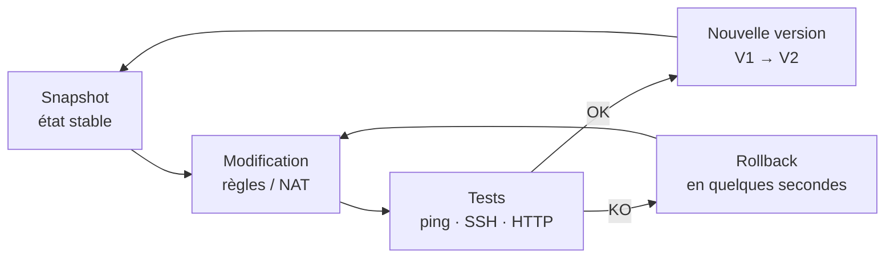

# 08 · Maintenance, continuité et évolutions

[⬅ Tests](07-tests-validation.md) · [README](../README.md)

## Stratégie de snapshots

Le pare-feu est l'élément le plus sensible : une règle mal placée peut couper l'accès à toute une zone (perte de l'anti-lockout) ou ouvrir une faille. Chaque changement suit donc un cycle court :

| Étape | Action |
|---|---|
| Avant | Snapshot de l'état stable de pfSense |
| Pendant | Application des nouvelles règles |
| Après | Rejeu des [tests de validation](07-tests-validation.md) |
| En cas d'échec | Restauration du snapshot |

## Bénéfices

- **Versionnement** : chaque snapshot correspond à une version de la politique de sécurité (V1, V2...)
- **Réduction des risques** : possibilité de tester des règles très restrictives sans crainte de se bloquer
- **Traçabilité** : les snapshots retracent l'évolution de la sécurité au fil du projet

## Évolutions prévues

### Haute disponibilité

pfSense est aujourd'hui un **point de défaillance unique (SPOF)**.
- Second nœud pfSense en cluster avec **CARP**
- Basculement transparent en cas de panne ou de maintenance

### Supervision

La détection d'une panne reste manuelle.
- Serveur **Zabbix** : CPU, RAM, trafic réseau de chaque VM
- **Traps SNMP** depuis pfSense et les serveurs Linux pour une alerte immédiate

### Sauvegardes automatisées et PRA

Les snapshots restent manuels et stockés sur l'hyperviseur.
- Export automatique des configurations pfSense et des dumps SQL hors de l'hôte
- **Plan de reprise d'activité** : reconstruire le datacenter en quelques minutes après un sinistre

### Durcissement

- Bloquer explicitement DMZ → Invités (aujourd'hui couvert par la règle de sortie générale)

### Retour sur Proxmox VE

- Déploiement sur un hôte dédié, comme prévu initialement
- Automatisation du déploiement

[⬅ Tests](07-tests-validation.md) · [README](../README.md)
